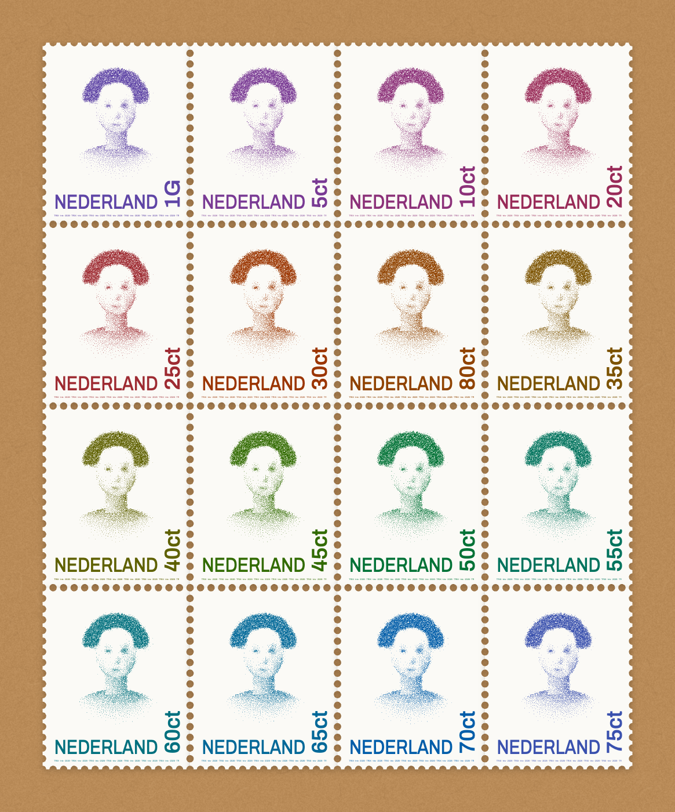

# Trix — a dot portrait machine after Peter Struycken

`trix.html` is a new, self-contained implementation of the algorithm Peter
Struycken developed with F.C.A. Groen and P.W. Verbeek (TU Delft, pattern
recognition group) for the dotted portrait of Queen Beatrix on the Dutch
definitive stamp. "Trix" is the queen's nickname. The tool puts **your** head
on that stamp.

Open `public/trix.html` in a browser (no build step), or serve the folder with
`npm start` to use the webcam on any browser. Chrome also allows the camera
on `file://`.



## What the original machine did

1. **Walk and pour.** The photo becomes 128 × 128 cells with grey values from
   0 (white) to 255 (black). A pen meanders over the rows (left to right, then
   right to left), adding each cell's grey to a running sum. When the sum
   reaches 255 a dot drops in that cell and the remainder is carried on:
   40 + 100 + 120 = 260 gives a dot and a carry of 5.
2. **Shake the box.** The dots still sit on a visible grid. Each dot owns a
   round territory. Dots take random steps of at most three positions, and a
   step into another dot's territory is cancelled. After 20 passes the grid
   has melted into an even, unpatterned spray.

## The new approach in Trix

Trix treats both phases as members of larger families, and adds what a
modern machine can do.

### Phase 1: a family of walks

The meander is one *space-filling walk*. Trix generalises the walk:

| Walk | Effect |
| --- | --- |
| Meander (1983) | the original; error is smeared along rows |
| Hilbert | a generalised Hilbert curve ("gilbert", any rectangle); error stays local in both directions, like Riemersma dithering |
| Spiral | outside in, leaves fingerprint-like whorls |
| Diagonal | a 45° meander |
| Rows | always left to right, with visible "worms" |
| Random | the counter-example: why the walk matters |

Every walk can be turned in one of eight orientations. The colour separations
use different orientations, like the screen angles of a printing press.
Accumulation uses exact integer arithmetic, so ink is conserved exactly:
dots × 255 + final carry = total grey. The tests prove this.

### Phase 2: hard-disk Monte Carlo, tone-adaptive

"Random steps, cancelled when they invade a territory" is exactly a
**hard-disk Metropolis Monte Carlo** simulation (Metropolis et al., 1953):
marbles in a tray. Trix implements it with a doubly linked uniform spatial
hash, so a move costs O(1), and adds:

- **Territories that follow the tone.** Instead of one fixed territory, every
  dot claims a share ("packing") of the local mean spacing 1/√density.
  Shadows stay dense, highlights get generous room, and every tone becomes
  even blue noise. The fixed 1983 territory is still available.
- **Continuous positions.** Dots leave the lattice completely. The original
  whole-cell moves are one switch away.
- **Multi-scale steps.** Step lengths are drawn as `max · u²`. Long jumps stay
  possible in the highlights, while dots packed in the shadows still find the
  little room next to them. With uniform steps, dark areas stayed on the grid.
  The tests caught this.
- **Relaxation.** Phase 1 sometimes leaves dots closer than their
  territories allow. A move that *reduces* an existing overlap is accepted, so
  those dots drift apart.
- **Annealing.** The step size can shrink pass by pass, like a cooling metal.
- **Tether.** Optionally limit how far a dot may wander from its cell, for
  razor-sharp edges.
- **Seeds.** All randomness comes from a seeded generator (mulberry32 over an
  FNV-1a hash), so any word is a seed. The same seed gives the same portrait,
  dot for dot, like a printing plate number. The seed is printed in the
  stamp's microtext.

### Tone

Before the walk, the photo goes through these steps:

- auto levels
- **auto tone**: it measures the median tone of the *face* (the inner part
  of the portrait oval) and picks the midtone curve that brings it to a
  stamp-like lightness, so a dark film scan and a bright selfie start from
  the same balance
- brightness and contrast
- a relative midtone gamma
- large-radius clarity
- unsharp "detail", so eyes, lips and nostrils earn their dots
- an oval background fade, the soft halo of the Beatrix portrait
- a "dot economy" factor; Struycken wanted as few dots as possible

### Marks and inks

The dots can be drawn as discs, squares, diamonds, rings, engraving dashes
oriented along the isophotes, cross-stitch crosses, letters, glowing lights,
or **one single line**. That last one is a travelling-salesman tour through
all dots: greedy nearest neighbour, then two-sided 2-opt and Or-opt on
k-nearest candidate lists. It is a plotter-ready stroke, a nod to the
original plots at the PTT's Dr. Neher Laboratory.

Ink modes: one ink, **CMYK** (four separations, each with its own walk
orientation and seed, multiplied), or **RGB light** (additive glows on
black).

## The interface

- **Source.** Drag to frame your face in the oval, scroll or pinch to zoom.
  Drop or paste a photo anywhere. *Machine eye* shows the tone map at grid
  resolution: what the machine actually sees.
- **Photo booth.** A webcam view with an oval guide and a **live dot
  mirror**, on by default, that runs the machine on the video in real time.
  It also has a 3-second timer, shutter sound and flash, a mirror switch, and
  a camera picker.
- **Stage.** A vector rendering. Scroll to zoom into individual dots, drag to
  pan, double-click to fit. The **loupe** is a philatelist's magnifier that
  re-renders the dots, perforation and microtext crisply. *Compare* (hold
  `\`) shows the photo.
- **Timeline.** Replay the whole performance: the dots are plotted along the
  walk (watch the meander or the Hilbert curve draw them), then the box is
  shaken. Scrub to any moment. Bars behind the track show how many moves each
  pass accepted. Optional sound: the pen ticks along the walk, and the
  marbles rattle more when more moves are accepted.
- **Recipes.** A strip of live thumbnails of *your* photo through every
  machine: Trix, Struycken 1983, Marbles, Crisp, Whorl, Unshaken, Engraving,
  One line, Trichrome, Night light, Typewriter and Cross-stitch.
- **Stamp.** A perforated stamp (20.8 × 25.6 mm, adjustable gauge) with the
  country name along the bottom and the value turned a quarter, as on the
  Beatrix stamps. The letters are printed through a 30° gravure dot screen
  whose dots close into solid letters, like Gerard Unger's rotogravure
  lettering: solid at a glance, a screen under the loupe. Letters can be
  knocked out of the portrait dots. Seed microtext is legible only under the
  loupe. Options: a
  postmark with today's date and your post office, an envelope, album or
  linen background, and a pair, a block of four, or a **series of sixteen**
  colours spaced evenly through the spectrum in OKLCH, as Struycken chose
  sixteen colours "from the whole spectrum".
- **Lab.** A histogram of nearest-neighbour distances for the moment on the
  timeline: spikes at 1 and √2 cells on the grid, one smooth hump once
  shaken.
- **Export.** PNG (3200 px), SVG at true stamp size in millimetres (dot fields
  defined once and reused per stamp), clipboard, a **movie** of the drop and
  the shake (MediaRecorder), and **print**: real 20.8 × 25.6 mm stamps on
  paper.
- **Comfort.** Undo (⌘/Ctrl-Z), settings links (`#t=…`, the photo stays
  local), saved presets, light and dark themes, and an accent colour that
  follows your ink. On phones you can shake the phone to re-shake the box.
  `?` lists the keyboard shortcuts.

Everything runs locally. Photos never leave the browser. Settings that arrive
by link, from storage or from presets are validated before use.

## Architecture

`trix.html` contains three inline scripts:

| Script | Role |
| --- | --- |
| `trix-core` | The engine. Pure functions, no DOM. The same text runs in the page, in Web Workers (spawned from a Blob of the script's own source, so it works from `file://`), and in Node. |
| `trix-render` | Scene geometry and drawing. It draws on any 2D context it is given, or returns SVG text, so stage, loupe, PNG, SVG and movie share one code path. |
| `trix-app` | UI state, the worker engine (newer jobs replace queued ones, stale long jobs are terminated), crop, controls built from a declarative spec, timeline, recipes, booth, export. |

## Tests

```bash
npm install
npm test            # engine unit tests + full runs on the photos in test-images/
npm run test:e2e    # drives trix.html in your installed Chrome (fake webcam included)
npm run test:all
```

- `tests/core.test.mjs` covers seeds, every walk (permutation, unit steps,
  orientations), the worked example from the Delft description, ink
  conservation, tone mapping, the 1983 territory rule, lattice moves, tether,
  relaxation, blue-noise spacing, k-NN against brute force, the line tour, and
  the perforation area.
- `tests/pipeline.test.mjs` runs every recipe on each photo in
  `test-images/`. It checks tone fidelity (Pearson correlation between the
  blurred dots and the blurred tone map), determinism, colour separations and
  speed, and writes contact sheets to `test-output/` for review by eye.
- `tests/e2e.test.mjs` covers loading, upload, all recipes, the timeline,
  stamp PNG and SVG, the 16-colour sheet, knock-out, real PNG/SVG/movie
  downloads, the photo booth and live mirror on Chrome's fake camera,
  settings links, undo, shortcuts, and phone width.

The engine is loaded *from the HTML* by the tests, so what is tested is
exactly what ships.

## Credits

Algorithm and stamp after Peter Struycken, F.C.A. Groen and P.W. Verbeek
(TU Delft) and Gerard Unger (lettering). Background:
<https://kalden.home.xs4all.nl/stru/struycken-nl.htm>.
Implementation by Vincent Bruijn with Claude (Anthropic), 2026.
